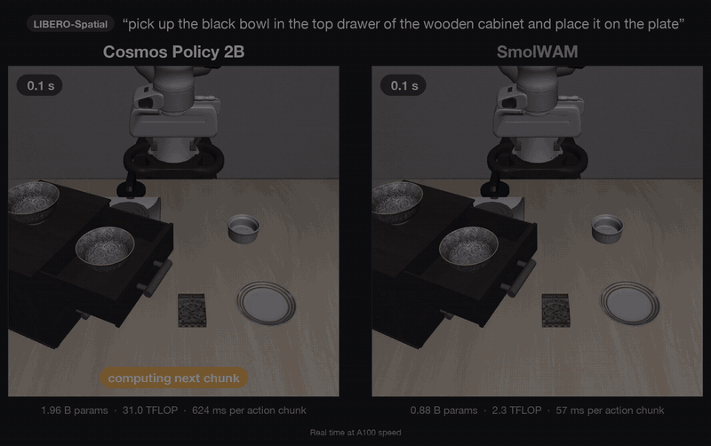
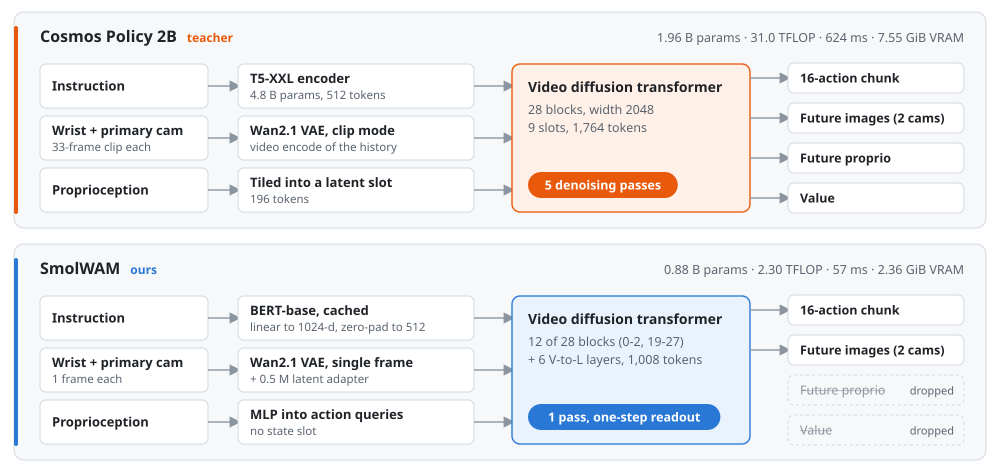
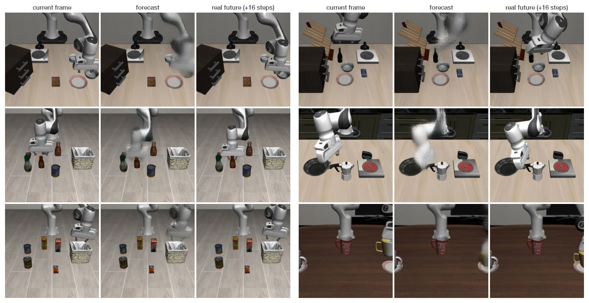

<div align="center">

# SmolWAM

### A Latent World-Action Model for Robotic Manipulation on Edge Devices

Timi Owolabi · Hikmah Olawore · Frances Adelakun · Ayotomiwa Oyewumi<br>
[ML Collective](https://mlcollective.org)

**NeurIPS 2026 Workshop on Robotics World Modeling**

[](https://smolwam.vercel.app)
[](paper/smolwam.pdf)
[](https://huggingface.co/timiiowolabi/SmolWAM)
[](https://huggingface.co/timiiowolabi/SmolWAM/resolve/main/media/smolwam_vs_cosmos_realtime.mp4)
[](LICENSE)
[](https://github.com/iitimii/SmolWAM/actions/workflows/ci.yml)

<a href="https://huggingface.co/timiiowolabi/SmolWAM/resolve/main/media/smolwam_vs_cosmos_realtime.mp4"></a>

<sub>Cosmos Policy 2B (left) and SmolWAM (right) from the same LIBERO initial state, both run closed loop. Before every
16-action chunk each robot waits for its model's measured A100 inference time (624 ms vs. 57 ms), so the clocks show
wall time at A100 speed.
<a href="https://huggingface.co/timiiowolabi/SmolWAM/resolve/main/media/smolwam_vs_cosmos_realtime.mp4">Watch the full 70-second comparison</a>.</sub>

</div>

**SmolWAM** is a 0.88B-parameter world-action model. From two camera images, the robot state and a language
instruction, a single forward pass predicts a 16-step action chunk *and* both camera views 16 steps ahead. We derive it
from NVIDIA's 2B-parameter [Cosmos Policy](https://github.com/NVlabs/cosmos-policy) by keeping the pretrained
video-diffusion trunk and rebuilding the inference interface around it. It keeps 97% of the teacher's LIBERO success
at 11× lower latency, trains in 3.6 GPU-hours, and runs on CUDA GPUs, Apple silicon and CPUs.

| | Cosmos Policy 2B | **SmolWAM** | |
|---|---:|---:|---:|
| LIBERO success (400 episodes) | 98.2% | **95.5%** | 97% of the teacher |
| Trunk parameters | 1.96 B | **0.88 B** | 2.2× fewer |
| Compute per 16-action chunk | 31.0 TFLOP | **2.30 TFLOP** | 13.5× less |
| Latency per chunk | 624 ms | **57 ms** | 11× faster |
| Peak GPU memory | 7.55 GiB | **2.36 GiB** | 3.2× less |
| Denoising steps | 5 | **1** | |

<sub>NVIDIA A100-40GB, batch 1, bf16, text features cached for both models. The teacher's 400-episode score comes from an
earlier evaluation pipeline; Cosmos Policy reports 98.5%.</sub>

## News

- **2026-10** · Code, weights and paper released. SmolWAM appears at the NeurIPS 2026 Workshop on Robotics World Modeling.

## Contents

[Installation](#installation) · [Quickstart](#quickstart) · [Examples](#examples) · [Evaluation](#evaluating-on-libero) ·
[Training](#training) · [Method](#method) · [Results](#results) · [Repository layout](#repository-layout) ·
[Citation](#citation)

## Installation

SmolWAM needs Python ≥ 3.10 and PyTorch ≥ 2.5. Inference runs on NVIDIA GPUs (CUDA), Apple silicon (MPS) and CPUs, in
plain PyTorch: neither NVIDIA-specific kernels nor the original Cosmos code base are required.

```bash
git clone https://github.com/iitimii/SmolWAM.git && cd SmolWAM
python -m venv .venv && source .venv/bin/activate

pip install -e .                    # inference
bash scripts/install_libero.sh      # + LIBERO simulation, on Linux or macOS
pip install -e ".[train]"           # + training and world-model metrics
```

### Model weights

`SmolWAM.from_pretrained("timiiowolabi/SmolWAM")` downloads the release from the
[Hugging Face Hub](https://huggingface.co/timiiowolabi/SmolWAM) on first use: `config.json`, `model.safetensors` (fp32,
3.5 GB) and `text_cache.safetensors`, plus the Wan2.1 VAE (`Wan-AI/Wan2.1-T2V-1.3B`, 0.5 GB). To keep a local copy:

```bash
hf download timiiowolabi/SmolWAM --local-dir checkpoints/SmolWAM   # then SmolWAM.from_pretrained("checkpoints/SmolWAM")
```

## Quickstart

```python
from smolwam import SmolWAM

policy = SmolWAM.from_pretrained("timiiowolabi/SmolWAM")  # downloads the weights and the Wan2.1 VAE once (~4 GB)

obs = {
    "primary_image": primary,  # (H, W, 3) uint8, upright third-person camera image (LIBERO: 256 x 256)
    "wrist_image": wrist,  # (H, W, 3) uint8, upright wrist camera image
    "proprio": proprio,  # (9,) gripper joint positions (2), end-effector position (3), quaternion (4)
}
actions = policy.predict_action(obs, "put the bowl on the plate")  # (16, 7): end-effector deltas (6), gripper (1)
```

In LIBERO, `smolwam.envs.libero.policy_observation(env_obs)` builds `obs` from a raw environment observation (the
simulator renders images upside down). The device defaults to CUDA, then MPS, then CPU, with bf16 on CUDA and fp32
elsewhere. Instructions outside the cached LIBERO set are encoded with BERT on the fly. `policy.last_timing` breaks down
the last query, and `predict_action(obs, instruction, return_future=True)` also returns the predicted latents of both
cameras, which `policy.decode_future(...)` turns into images. [`examples/quickstart.py`](examples/quickstart.py) runs
this end to end on a bundled LIBERO observation.

## Examples

| Script | What it does |
|---|---|
| [`examples/quickstart.py`](examples/quickstart.py) | Downloads SmolWAM and predicts one action chunk for a bundled LIBERO observation. Prints the timing breakdown. |
| [`examples/libero_rollout.py`](examples/libero_rollout.py) | Runs one closed-loop LIBERO episode and saves it as an MP4. |
| [`examples/world_model.py`](examples/world_model.py) | Decodes SmolWAM's forecast of both cameras 16 steps ahead and saves it next to the current view. |

## Evaluating on LIBERO

All evaluations use seed 195 and the fixed initial states of LIBERO.

```bash
# Full protocol: 4 suites × 10 tasks × 10 trials = 400 episodes (reported: 95.5%)
python -m smolwam.eval_libero --protocol full --out outputs/eval_full.json

# 60-episode screening set (3 tasks per suite × 5 trials; reported: 93.3%) and a 12-episode smoke test
python -m smolwam.eval_libero --protocol screen --out outputs/eval_screen.json
python -m smolwam.eval_libero --protocol smoke --out outputs/eval_smoke.json

# One task with a video, e.g. on a MacBook (about 0.9 s per query on an M2 Pro)
python -m smolwam.eval_libero --tasks libero_10:2 --num_trials 1 \
    --save_video_dir outputs/videos --video_every_step --out outputs/libero_10_task2.json

# Inference cost: parameters, FLOPs, latency, peak memory
python -m smolwam.bench --out outputs/bench.json
```

Every command takes `--model` (a Hub repo id or a local release directory; default `timiiowolabi/SmolWAM`),
`--device` and `--dtype`. [`experiments/`](experiments) has the exact command behind every number in the paper, with
the expected result and the hardware we used.

## Training

Training needs one GPU with 40 GB of memory and the
[LIBERO-Cosmos-Policy](https://huggingface.co/datasets/nvidia/LIBERO-Cosmos-Policy) demonstrations. The distillation
targets come from the original [Cosmos Policy](https://huggingface.co/nvidia/Cosmos-Policy-LIBERO-Predict2-2B)
checkpoint, which SmolWAM's own trunk code runs, so the upstream code base is not needed.

```bash
bash experiments/train_smolwam.sh
# latent bank -> latent adapter -> text cache -> teacher targets -> train (5,000 steps) -> export to runs/smolwam/release
```

The exported directory has the format of the Hugging Face release and loads with `SmolWAM.from_pretrained`. Each step,
its expected output and its run time are listed in [`experiments/README.md`](experiments/README.md). Evaluating the
teacher itself (`--policy cosmos`) is the one command that needs the upstream
[cosmos-policy](https://github.com/NVlabs/cosmos-policy) package.

## Method



Cosmos Policy treats actions, future observations and values as latent frames of one denoising sequence. Its
inference stack, however, was built for video generation: a 4.8B-parameter T5-XXL text encoder, a 33-frame clip
encoding per query, and five denoising passes over 1,764 tokens. SmolWAM keeps the trunk's weights, token positions and
rectified-flow readout, and changes five things. Most of these changes break the trunk when applied zero-shot, so each
one is checked with a diagnostic and then recovered by distillation:

| Change | What SmolWAM does |
|---|---|
| Single-frame latents | Encodes each camera image once with the Wan2.1 VAE encoder; a 0.5M-parameter adapter maps it into the clip-mode latent space the trunk expects. |
| Cached text that keeps the attention sinks | BERT-base features, zero-padded to 512 positions: the trunk relies on T5's ~500 zero-padded positions as attention sinks. Six zero-initialised vision-to-language layers let the instruction attend to the images. |
| Boundary-preserving pruning | Keeps blocks 0–2 and 19–27 of 28 (0.88 B parameters). |
| State-conditioned action queries | 28 queries, offset by an MLP of the robot state, replace the 196-token action frame at its original positions; only the blank and image frames remain (1,008 tokens). |
| One-pass readout | Runs the trunk once at maximum noise with fixed noise and reads actions and future latents from the clean estimate x̂₀ = x_τ − τ·v_θ. |


The student is initialised from the kept teacher blocks and trained with L1 losses against the demonstrations and the
teacher's cached one-step predictions. Pruning and compaction are separate distribution shifts, so training runs in the
teacher's 1,764-token layout for the first 1,000 of 5,000 steps and in the compact layout afterwards.

> **A pitfall worth knowing.** Cosmos Policy uses RoPE spatial extrapolation 3.0 with frame-rate modulation turned
> off. A trunk rebuilt with the library defaults loads the weights without any error, yet its output shifts by half a
> standard deviation and the action error rises from 0.009 to 0.40. SmolWAM's trunk ([`smolwam/nn/dit.py`](smolwam/nn/dit.py))
> fixes these values.

## Results

### LIBERO

| Model | Trunk | TFLOP | Latency | Memory | Spatial | Object | Goal | Long | Average |
|---|---:|---:|---:|---:|---:|---:|---:|---:|---:|
| Cosmos Policy 2B (5 steps) | 1.96 B | 31.0 | 624 ms | 7.55 GiB | 97.0 | 100.0 | 99.0 | 97.0 | 98.2 |
| **SmolWAM** (1 step) | 0.88 B | 2.30 | **57 ms** | 2.36 GiB | 99.0 | 100.0 | 94.0 | 89.0 | **95.5** |

<sub>Success rate (%) over 400 episodes (40 tasks × 10 trials). Cost is per 16-action chunk on one A100 (batch 1,
bf16); TFLOP counts the trunk and the VAE encoder; memory is peak GPU memory. The teacher's per-suite results come from
an earlier evaluation pipeline.</sub>

SmolWAM succeeds in 382 of 400 episodes (95% Wilson interval 93.0–97.1%). There is no detectable gap on Spatial and
Object. The deficit is in the multi-step Goal and Long suites, where failed rollouts usually complete the first subgoal
and then stall on the second. At 57 ms per chunk (6.8 ms preprocessing, 12.9 ms VAE encoding, 36.9 ms trunk), SmolWAM
issues 17.7 chunks, or 282 actions, per second. On a MacBook Pro (M2 Pro GPU, fp32) a chunk takes about 0.9 s.

<details>
<summary><b>Variants and negative results</b> (60-episode screening set)</summary>

| Model | Trunk | TFLOP | Latency | Screening | Full |
|---|---:|---:|---:|---:|---:|
| Cosmos Policy 2B (5 steps) | 1.96 B | 31.0 | 624 ms | 96.7 | 98.2 |
| Cosmos Policy 2B, 1 step on single-frame latents | 1.96 B | 7.52 | 126 ms | 100.0 | – |
| **SmolWAM** | 0.88 B | 2.30 | 57 ms | 93.3 | **95.5** |
| SmolWAM, 7,500 more training steps | 0.88 B | 2.30 | 60 ms | 93.3 | 94.2 |
| SmolWAM, INT8 weights (simulated) | 0.88 B | 2.30 | 65 ms ‡ | 91.7 | – |
| SmolWAM, 8 blocks | 0.60 B | 1.76 | 134 ms ‡ | 83.3 | – |
| SmolWAM + latent-action cascade (4-step flow matching) | 0.92 B | 4.28 | 239 ms | 53.3 | – |

<sub>‡ Measured on a shared GPU. INT8 is simulated: weights quantised per channel, kernels in bf16.</sub>

- **The interface was most of the cost.** Running the unmodified teacher for one step on single-frame latents already
  cuts latency 5× with no loss on the screening set. SmolWAM's trunk redesign adds another 2.2× in latency, 3.3× in
  compute and 1.9× in memory.
- **Richer world-action components hurt at this scale.** Porting ABot-M0.5's recipe onto SmolWAM (a frozen
  latent-action stream behind an asymmetric mask, mixture-of-transformer towers, four-step flow matching and dream
  forcing) drops success to 53.3%. Fine-tuning its world head with rewards from optical flow, depth or LPIPS worsened
  every image metric and collapsed success to 5–17%.

</details>

### The world head still forecasts motion



On 96 held-out contexts, SmolWAM's forecast of the camera view 16 steps ahead lowers latent L1 error by 24% relative to
copying the current frame (0.101 vs. 0.133). The end-point error between optical flow to the forecast and optical flow
to the real future drops from 1.63 to 1.43 pixels. LPIPS stays at the copy-frame level (0.128 vs. 0.115): the world head
captures motion, not texture.

Every number in this README has its record in [`results/`](results).

## Limitations

- SmolWAM is evaluated in simulation on LIBERO only; it has not been run on a real robot or another benchmark.
- Pruning depth hurts long-horizon tasks the most (LIBERO-Long: 89%). Pruning that preserves long-horizon control is
  open.
- Every cost is measured on one A100, and INT8 is simulated. SmolWAM has not yet been measured on an embedded device.
- All results come from a single training seed.

## Repository layout

```
smolwam/            the package
  nn/               the diffusion-transformer trunk, the Wan2.1 VAE and the latent adapter, in plain PyTorch
  model.py          the network: trunk, text and state conditioning, action queries, one-step readout
  policy.py         SmolWAM.from_pretrained(...).predict_action(obs, instruction)
  layout.py         the latent-frame layout shared with Cosmos Policy
  eval_libero.py    closed-loop LIBERO evaluation       bench.py    parameters, FLOPs, latency, memory
  world_eval.py     world-head metrics                  export.py   training checkpoint -> release directory
  envs/             LIBERO environment helpers          train/      data pipeline, distillation, training
examples/           runnable usage examples
experiments/        the commands behind every number in the paper
results/            evaluation and benchmark records for every reported number
scripts/            LIBERO installation
paper/              the workshop paper (PDF and LaTeX source)
tests/              unit tests and a regression test against the released weights
```

## Citation

```bibtex
@inproceedings{owolabi2026smolwam,
  title     = {SmolWAM: A Latent World-Action Model for Robotic Manipulation on Edge Devices},
  author    = {Owolabi, Timi and Olawore, Hikmah and Adelakun, Frances and Oyewumi, Ayotomiwa},
  booktitle = {NeurIPS 2026 Workshop on Robotics World Modeling},
  year      = {2026},
  url       = {https://smolwam.vercel.app}
}
```

## Acknowledgements

SmolWAM builds on [Cosmos Policy](https://github.com/NVlabs/cosmos-policy), whose trunk it inherits and whose code
[`smolwam/nn/dit.py`](smolwam/nn/dit.py) adapts; the [Wan2.1](https://github.com/Wan-Video/Wan2.1) VAE; the efficiency
recipe of TurboVLA and the latent-action recipe of ABot-M0.5; and the [LIBERO](https://libero-project.github.io)
benchmark.

## License

The code is released under the [Apache 2.0 license](LICENSE); adapted third-party code keeps its notices
([NOTICE](NOTICE)). The SmolWAM weights are derived from `nvidia/Cosmos-Policy-LIBERO-Predict2-2B` and are released
under the [NVIDIA One-Way Noncommercial License](https://huggingface.co/timiiowolabi/SmolWAM/blob/main/LICENSE), for
non-commercial research and educational use only.
